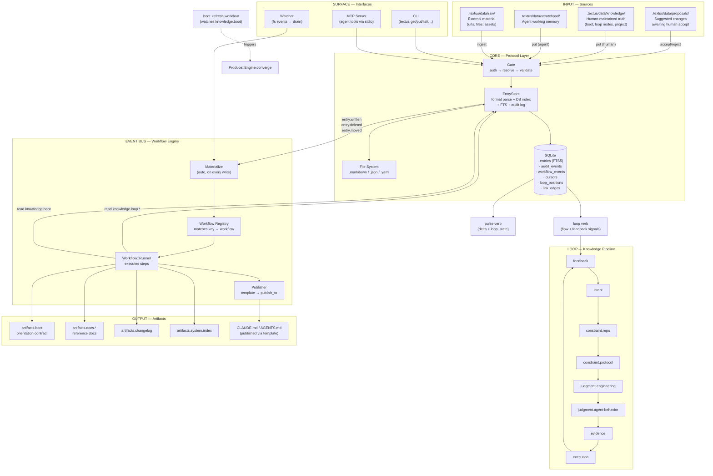

# Data Flow

```
┌─────────────────────────────────────────────────────────────────────┐
│                           INPUT (Sources)                           │
│                                                                     │
│  ┌──────────┐  ┌──────────┐  ┌──────────┐  ┌──────────┐           │
│  │  raw/    │  │knowledge/│  │scratchpad│  │proposals/│           │
│  │external  │  │human     │  │agent     │  │pending   │           │
│  │material  │  │truth     │  │memory    │  │changes   │           │
│  └────┬─────┘  └────┬─────┘  └────┬─────┘  └────┬─────┘           │
│       │  ingest     │  put        │  put        │  accept/reject   │
│       ▼             ▼             ▼             ▼                  │
├─────────────────────────────────────────────────────────────────────┤
│                         CORE (Protocol Layer)                       │
│                                                                     │
│  ┌──────────────────────────────────────────────────────────────┐   │
│  │                    Gate (auth → resolve → validate)          │   │
│  └────────────────────────┬─────────────────────────────────────┘   │
│                           │                                         │
│                           ▼                                         │
│  ┌──────────────────────────────────────────────────────────────┐   │
│  │  EntryStore (format parse + DB index + FTS + audit log)     │   │
│  └──┬───────────────────────────────────────────────┬──────────┘   │
│     │ write                                         │ read         │
│     ▼                                               ▼              │
│  ┌──────────┐  ┌───────────────────────────────────────────────┐   │
│  │FileSystem│  │                   SQLite                       │   │
│  │.md .json │  │ ┌──────────┐┌──────────┐┌───────────────┐    │   │
│  │.yaml on  │  │ │ entries  ││ audit    ││workflow_events│    │   │
│  │disk      │  │ │ (FTS5)   ││_events   ││(event queue)  │    │   │
│  └──────────┘  │ ├──────────┤├──────────┤├───────────────┤    │   │
│                │ │ cursors  ││loop_pos  ││ link_edges    │    │   │
│                │ └──────────┘└──────────┘└───────────────┘    │   │
│                └──────────────────────────────────────────────┘   │
├─────────────────────────────────────────────────────────────────────┤
│                     EVENT BUS (Workflow Engine)                     │
│                                                                     │
│  entry.written / entry.deleted / entry.moved                        │
│         │                                                           │
│         ▼                                                           │
│  ┌──────────────┐    ┌──────────────┐    ┌──────────────┐          │
│  │  Materialize │───>│    Workflow   │───>│  Workflow::  │          │
│  │ (auto, on    │    │   Registry    │    │   Runner     │          │
│  │  every write) │    │ (key→workflow)│    │ (exec steps) │          │
│  └──────────────┘    └──────────────┘    └──────┬───────┘          │
│                                                  │                  │
│                     ┌────────────────────────────┼──────┐           │
│                     │                            │      │           │
├─────────────────────────────────────────────────────────────────────┤
│  KNOWLEDGE LOOP      │            ┌──────────┐   │      │           │
│                      │            │  boot_   │   │      │           │
│  ┌──────┐            │            │ refresh  │   │      │           │
│  │intent│◄───────────┼────────────│ (watches │   │      │           │
│  └──┬───┘            │            │know.boot)│   │      │           │
│     ▼                │            └─────┬────┘   │      │           │
│  ┌──────────┐        │                  │triggers│      │           │
│  │constraint│        │                  ▼        │      │           │
│  │ .repo    │        │           ┌──────────┐    │      │           │
│  │ .protocol│        │           │Produce:: │    │      │           │
│  └──┬───────┘        │           │Engine.con│    │      │           │
│     ▼                │           │verge     │    │      │           │
│  ┌──────────┐        │           └──────────┘    │      │           │
│  │judgment  │        │                           │      │           │
│  │.engineer │        │                           ▼      ▼           │
│  │.agent-beh│        │                    ┌──────────────────┐     │
│  └──┬───────┘        │                    │  Publisher       │     │
│     ▼                │                    │  (templating +   │     │
│  ┌──────────┐        │                    │  publish_to)     │     │
│  │evidence  │        │                    └────────┬─────────┘     │
│  └──┬───────┘        │                             │               │
│     ▼                │                             │               │
│  ┌──────────┐        │                             ▼               │
│  │execution │        │                    ┌──────────────────┐     │
│  └──┬───────┘        │                    │  CLAUDE.md       │     │
│     ▼                │                    │  AGENTS.md       │     │
│  ┌──────────┐        │                    │  README.md       │     │
│  │ feedback │        │                    └──────────────────┘     │
│  │(signals: │        │                                             │
│  │promote/  │        │                                             │
│  │eliminate │        │                                             │
│  │/refine)  │        │                                             │
│  └──────────┘        │                                             │
│                      │                                             │
├──────────────────────┼──────────────────────────────────────────────┤
│                      │                                             │
│  OUTPUT              ▼                                             │
│  ┌────────────────────────────────────────────────────────────┐    │
│  │  artifacts.boot     artifacts.docs.*  artifacts.changelog  │    │
│  │  artifacts.system.index  (+ 40+ config/workflow outputs)   │    │
│  └────────────────────────────────────────────────────────────┘    │
│                                                                     │
│  SURFACE (CLI / MCP Server / Watcher) → all verbs hit Gate         │
│  pulse → cursor_store + loop_state  |  loop → flow + feedback      │
└─────────────────────────────────────────────────────────────────────┘
```

## Mermaid version



## Key flows

- **Write path:** `put` → Gate (auth/resolve/validate) → EntryStore (file + DB index + audit + FTS) → Materialize → Workflow Runner → reads knowledge → produces artifacts → Publisher → CLAUDE.md/AGENTS.md
- **Read path:** `get` → Gate → Manifest resolver (key→path) → FileSystem (read bytes) → Format parser (md/json/yaml → envelope) → response
- **Loop cycle:** intent → constraint → judgment → evidence → execution → feedback → (repeat); `pulse` returns position, `loop` returns flow + feedback signals
- **Boot refresh:** writing `knowledge.boot` → Materialize → boot_refresh workflow → triggers produce on `artifacts.boot` → boot workflow regenerates
