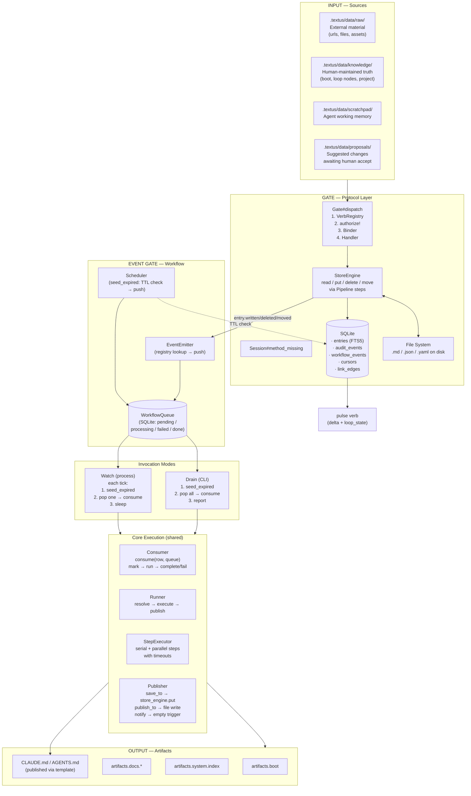

# Data Flow

```
┌──────────────────────────────────────────────────────────────────────┐
│                            INPUT (Sources)                           │
│                                                                      │
│  ┌──────────┐  ┌──────────┐  ┌──────────┐  ┌──────────┐            │
│  │  raw/    │  │knowledge/│  │scratchpad│  │proposals/│            │
│  │external  │  │human     │  │agent     │  │pending   │            │
│  │material  │  │truth     │  │memory    │  │changes   │            │
│  └────┬─────┘  └────┬─────┘  └────┬─────┘  └────┬─────┘            │
│       │  ingest     │  put        │  put        │  accept/reject    │
│       ▼             ▼             ▼             ▼                   │
├──────────────────────────────────────────────────────────────────────┤
│                     GATE (Protocol Layer)                            │
│                                                                      │
│  ┌──────────────────────────────────────────────────────────────┐   │
│  │  Session#method_missing → Bridge#dispatch → Gate#dispatch    │   │
│  │   1. VerbRegistry.for(verb)    2. authorize! (write only)     │   │
│  │   3. Protocol::Binder.bind     4. resolve handler             │   │
│  │   5. handler.public_send(verb, **args, ctx:, call:)          │   │
│  └──────────────────────┬───────────────────────────────────────┘   │
│                         │                                           │
│             ┌───────────┴───────────┐                               │
│             │ read (QueryContext)   │ write (CommandContext)        │
│             ▼                       ▼                               │
│  ┌────────────────────┐  ┌──────────────────────────┐               │
│  │  StoreEngine#read  │  │  StoreEngine#put          │               │
│  │  read file from    │  │  → PutPipeline:           │               │
│  │  disk, parse       │  │    Validate → Prepare →   │               │
│  │  format, return    │  │    Write → Emit           │               │
│  │  envelope          │  │  FileSystem + SQLite      │               │
│  └────────────────────┘  └──────────┬───────────────┘               │
│                                     │                               │
│                                     ▼                               │
├──────────── EVENT GATE ─────────────────────────────────────────────┤
│                                                                      │
│  ┌──────────────────────────────────────────────────────────────┐   │
│  │  EventEmitter (centralized event gate)                       │   │
│  │  Receives from: Store writes (put/delete/move), Scheduler    │   │
│  │  (TTL expired), actor calls                                  │   │
│  │  Validates → looks up matching workflows → pushes to queue   │   │
│  └──────────────────────┬───────────────────────────────────────┘   │
│                         │                                           │
│                         ▼                                           │
│  ┌──────────────────────────────────────────────────────────────┐   │
│  │  Infra::Store::WorkflowQueue (SQLite)                       │   │
│  │  ┌──────────┐ ┌──────────┐ ┌──────────┐ ┌──────────┐       │   │
│  │  │ pending  │ │processing│ │ failed   │ │ done     │       │   │
│  │  └──────────┘ └──────────┘ └──────────┘ └──────────┘       │   │
│  └──────────────────────┬───────────────────────────────────────┘   │
│                         │                                           │
│             ┌───────────┴───────────┐                               │
│             │                       │                               │
│        Drain mode             Watch mode                            │
│        (CLI, one-shot)        (process, continuous)                 │
│             │                       │                               │
│      1. seed_expired           each tick:                           │
│      2. pop all → consume      1. seed_expired                      │
│      3. report {ok, failed}    2. pop one → consume                 │
│                                 3. sleep(poll_interval)             │
│             │                       │                               │
│             └───────────┬───────────┘                               │
│                         │                                           │
├─────────────────────────┼───────────────────────────────────────────┤
│                         ▼                                           │
│  ┌──────────────────────────────────────────────────────────────┐   │
│  │  Core Execution (shared)                                    │   │
│  │                                                              │   │
│  │  Consumer.consume(row, queue)                                │   │
│  │    → mark_processing → Runner.run → complete or fail/resched │   │
│  │                                                              │   │
│  │  Runner.run(key) → resolve → StepExecutor.execute → Publish  │   │
│  │                                                              │   │
│  │  StepExecutor: serial steps (with timeout)                   │   │
│  │                parallel steps (Concurrent::Promise)           │   │
│  │                                                              │   │
│  │  Publisher: save_to → store_engine.put                       │   │
│  │             publish_to → file write via template             │   │
│  │             notify → empty trigger puts                      │   │
│  └──────────────────────────────────────────────────────────────┘   │
│                                                                      │
├──────────────────────────────────────────────────────────────────────┤
│                                                                      │
│  OUTPUT                                                              │
│  ┌──────────────────────────────────────────────────────────────┐   │
│  │  artifacts.boot     artifacts.docs.*  artifacts.changelog    │   │
│  │  artifacts.system.index  (+ published CLAUDE.md, AGENTS.md)  │   │
│  └──────────────────────────────────────────────────────────────┘   │
│                                                                      │
│  SURFACES: CLI (textus get/put/list/...)                            │
│            MCP Server (agent tools via stdio)                       │
│            Watcher (poll loop, seed_expired + consume)              │
└──────────────────────────────────────────────────────────────────────┘
```

## Key flows

- **Write path:** `put` → Session → Gate → StoreEngine#put → PutPipeline (Validate → Prepare → Write → Emit) → FileSystem + SQLite → EventEmitter → WorkflowQueue
- **Read path:** `get` → Session → Gate → StoreEngine#read → FileSystem read → Format parser → envelope
- **Drain (CLI):** `drain` → Scheduler.seed_expired (TTL checks) → pop all pending from WorkflowQueue → Consumer.consume each → Runner → StepExecutor → Publisher
- **Watch (process):** Watcher tick → seed_expired → pop one → consume → sleep → repeat; triggered writes push events immediately via EventEmitter
- **Workflow execution:** EventEmitter receives event → looks up registry → pushes to WorkflowQueue → Consumer picks up → Runner resolves key → StepExecutor runs steps → Publisher writes save_to/publish_to/notify targets
- **Scheduler seeding:** Scheduler checks each workflow with TTL + save_to: if entry missing or older than TTL, pushes a "workflow" event to the queue

## Mermaid version


